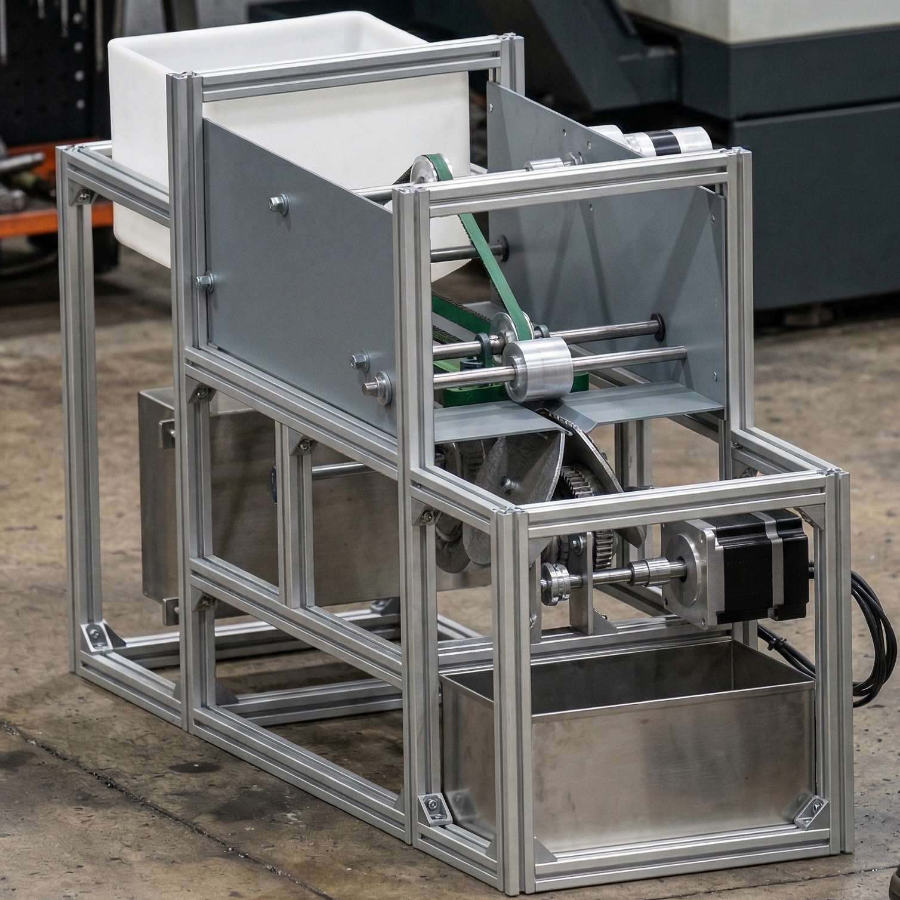
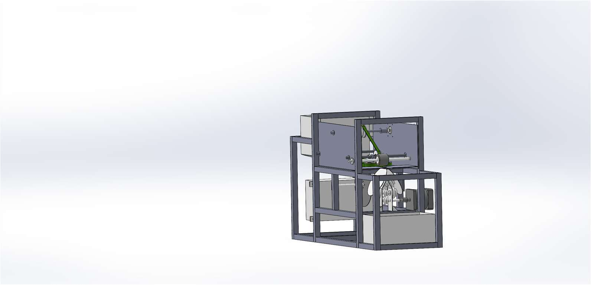
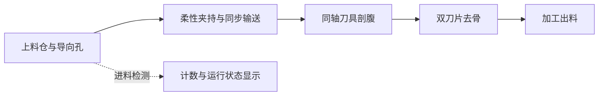
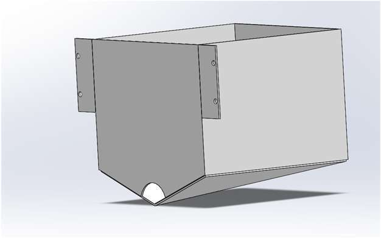
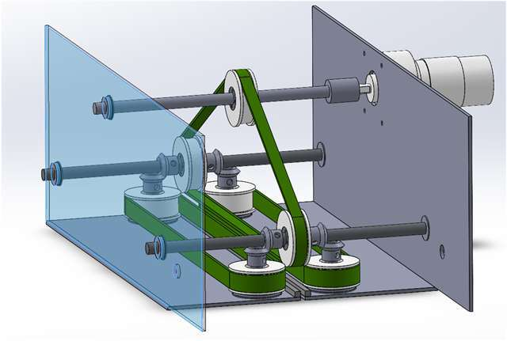
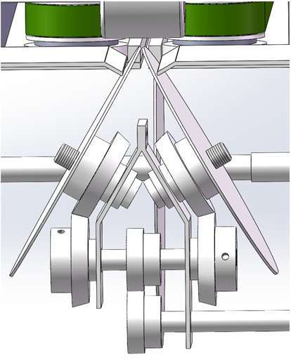
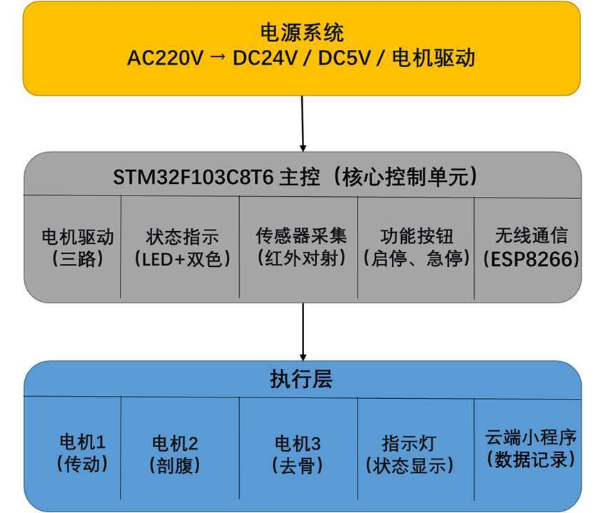
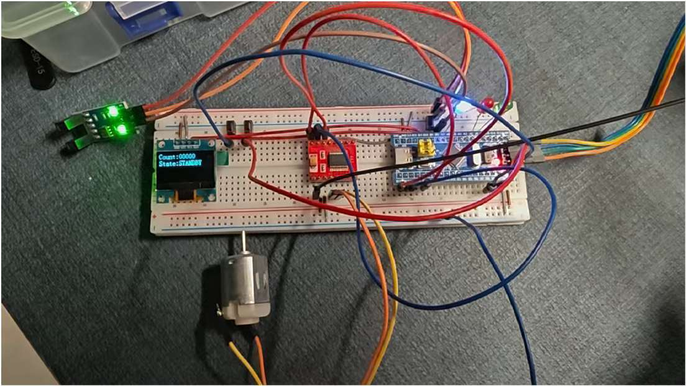

# 智鳝净鲜：多模态协同黄鳝自动化加工一体机

**黄鳝一体化加工设备｜机械结构设计与样机制作｜STM32 嵌入式控制**

“智鳝净鲜”面向黄鳝深加工与预制菜生产场景，针对黄鳝体表黏液多、易扭动、个体尺寸差异大以及人工前处理难以保持加工一致性等问题，将定向进料、柔性夹持输送、剖腹、去骨与加工计数纳入一体化设备。项目已完成需求分析、机械结构设计、三维数字建模、零件加工与采购、样机制作及电控测试，并获得**同济大学机械创新设计大赛二等奖**。

本仓库集中展示项目的机械方案、样机成果与电控程序，提供可直接在 Keil 中打开的 STM32F103 工程及配套说明。

<p align="center">
  
</p>
<p align="center"><em>项目样机实物</em></p>

## 项目背景

黄鳝加工同时涉及物料定向、可靠夹持、连续输送和刀具定位。黏滑的体表增加了定位难度，鱼体扭动及尺寸差异又会影响切入位置和加工稳定性。围绕这些工况，项目将机械传动、柔性接触与嵌入式控制结合，完成了从单个工序到整机加工流程的集成设计。

设备面向需要统一前处理流程的黄鳝深加工企业、中央厨房及预制菜生产场景，关注连续作业、加工一致性、物料保护和结构成本之间的平衡。

## 已完成成果

| 成果 | 具体内容 |
| --- | --- |
| 整机与机构设计 | 完成进料、夹持输送、剖腹、去骨及机架的结构设计与三维装配建模 |
| 实体样机 | 完成零件采购、自加工和样机制作，形成可展示的整机实物 |
| 电控设计与测试 | 完成基于 STM32F103 的控制设计，搭建电控测试电路，验证启停、计数、状态显示及报警处理等功能 |
| 程序归档 | 保存应用状态机、外设驱动、启动文件、标准外设库及 Keil 工程配置 |
| 竞赛成果 | 同济大学机械创新设计大赛二等奖 |

<p align="center">
  
</p>
<p align="center"><em>整机三维装配模型</em></p>

## 加工流程



### 定向进料

上料仓结合黄鳝趋触与钻洞习性设置导向孔，并利用仓体倾斜和重力导向组织物料进入后续工位。结构设计围绕头部朝前、单只有序进入的要求展开，使进料方向与输送机构衔接。进料检测环节通过红外传感信号完成数量采集，为加工计数提供输入。

<p align="center">
  
</p>

### 单驱三带柔性夹持输送

夹持输送机构通过单电机与机械传动带动三条传送带协同运动，协调接触位置与输送速度。柔性带面在输送过程中约束鱼体运动，为后续剖腹和去骨提供定位条件，同时减少刚性夹持对体表和肉质的挤压损伤。

这里的“单驱”指**夹持输送机构内部使用一个动力源**，整机的输送、剖腹和去骨工位分别设置驱动。

<p align="center">
  
</p>

### 同轴剖腹

剖腹机构采用电机主轴与剖割刀片同轴连接的结构，缩短动力传递路径，减少中间传动环节。刀具位置与前端夹持输送机构配合，使物料沿确定路径进入剖切工位。

### 单动力源双刀片去骨

去骨机构围绕黄鳝骨骼结构安排双刀片的空间位置与切入姿态，通过机械传动实现单动力源驱动双刀片协同作业，完成去骨工位的机构集成，并控制多电机配置带来的结构与控制复杂度。

<p align="center">
  
</p>

## 电控系统与程序

整机电控架构以 **STM32F103C8T6** 为核心，围绕输送、剖腹、去骨三个工位组织驱动，并结合传感器采集、功能按钮和状态指示完成操作与监测。下图为项目电控系统架构。

<p align="center">
  
</p>

仓库中的 [`firmware/stm32f103`](firmware/stm32f103) 保存的是项目的**电控测试程序**，实现单路电机的 PWM 与方向控制、驱动使能、红外计数、OLED 显示、按键消抖，以及待机、运行、报警和急停四种状态的切换。该程序用于展示核心控制逻辑，与整机架构图中的三路驱动和无线数据层具有不同的归档范围；ESP8266、云端小程序及视觉识别模块的源码不包含在本次工程中。

<p align="center">
  
</p>
<p align="center"><em>电控测试电路：主控、按键、红外传感器、驱动、电机及 OLED 显示</em></p>

程序说明、状态转换、引脚分配及编译方法见 [电控程序使用说明](docs/firmware-guide.md)。

## 仓库结构

```text
Eel_processing_machine/
├── README.md
├── docs/
│   ├── firmware-guide.md             # 编译、接线与控制流程
│   └── images/                       # 整机、机构及电控展示图
├── firmware/
│   └── stm32f103/
│       ├── Project.uvprojx            # Keil 工程入口
│       ├── User/                     # 主循环与四状态控制
│       ├── Hardware/                 # 电机、计数、按键与显示驱动
│       ├── System/                   # 毫秒时基与延时
│       ├── Start/                    # 启动文件、CMSIS 与时钟配置
│       ├── Library/                  # STM32F10x 标准外设库
│       ├── DebugConfig/              # 调试配置
│       └── SOURCE_MANIFEST.sha256     # 原始工程文件校验值
└── THIRD_PARTY_NOTICES.md
```

## 打开与编译

1. 使用 Keil MDK-ARM / µVision 5 打开 [`Project.uvprojx`](firmware/stm32f103/Project.uvprojx)。
2. 按工程配置安装 STM32F1 设备支持包，选择 `STM32F103C8` 与 `Target 1`。
3. 使用与原工程一致的 ARM Compiler 5.06 系列工具链进行编译。详细版本和输出位置见 [程序使用说明](docs/firmware-guide.md#编译工程)。
4. 根据说明核对测试板引脚，使用与实际硬件匹配的调试器下载程序。

源码按原始字节归档，保留原有编码和工程相对路径。编译输出、历史构建日志和个人 IDE 布局文件由 `.gitignore` 排除。

## 团队

项目团队来自同济大学机械工程与机器人学院，成员为**戈泽锴、刘炳尧、刘志强、王彦清**，其中戈泽锴担任项目负责人。

## 展示资料与代码说明

页面中的整机模型、样机及电控图片提取自团队项目展示资料，保留原资料中的模型与实物内容。仓库当前归档范围为展示图片与电控工程；三维 CAD 源文件及完整试验数据未随本次提交发布。

STM32 标准外设库及 CMSIS 文件保留各自原始版权和声明，详见 [第三方组件说明](THIRD_PARTY_NOTICES.md)。
