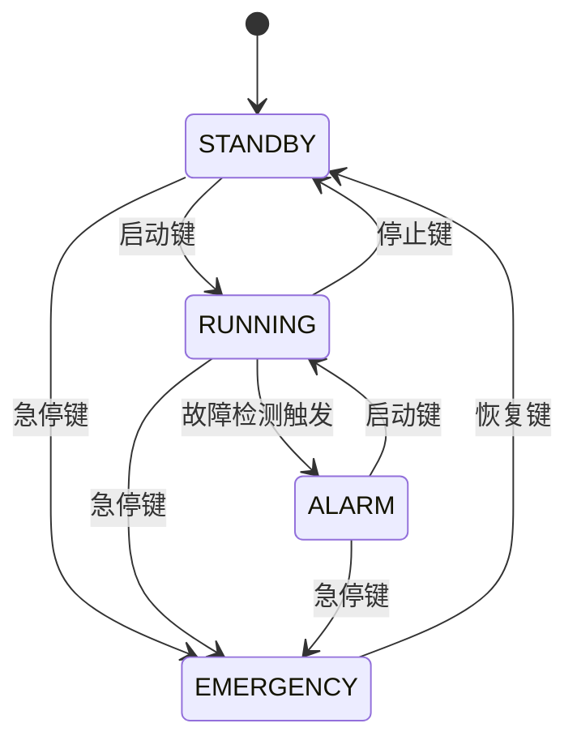

# 电控程序使用说明

本工程是“智鳝净鲜”黄鳝加工机的 STM32 电控测试程序，采用标准外设库和循环状态机组织控制流程。工程文件保留原始目录结构与源码字节，可在 Keil 中直接打开。

## 工程配置

| 项目 | 配置 |
| --- | --- |
| 工程入口 | `firmware/stm32f103/Project.uvprojx` |
| 目标名称 | `Target 1` |
| MCU | 工程配置为 `STM32F103C8`，项目主控为 STM32F103C8T6 |
| 内核 | ARM Cortex-M3 |
| 原工程编译器 | ARM Compiler 5.06 update 5，build 528 |
| 原工程设备包 | `Keil.STM32F1xx_DFP.2.2.0` |
| 标准外设库 | STM32F10x Standard Peripheral Library V3.5.0 |
| 预处理定义 | `USE_STDPERIPH_DRIVER` |
| 头文件目录 | `Start`、`Library`、`User`、`System`、`Hardware` |
| 启动文件 | `Start/startup_stm32f10x_md.s` |
| 输出位置 | `Objects/`，链接产物为 `Project.axf` |

## 已归档功能

| 功能 | 实现位置 | 行为 |
| --- | --- | --- |
| 状态调度 | `User/main.c` | 比较 `CurrMode` 与 `NextMode`，执行旧状态退出、新状态初始化或当前状态循环 |
| 共享任务 | `User/Global.c` | 扫描按键、更新计数显示、处理计数清零和呼吸灯 |
| 电机控制 | `Hardware/Motor.c`、`PWM2.c` | PWM 输出、方向控制、驱动使能与故障标志 |
| 红外计数 | `Hardware/CountSensor.c` | PB0 上升沿中断，运行状态下计数，触发间隔大于 20 ms |
| 按键输入 | `Hardware/Key.c` | 20 ms 消抖、单次按下触发，急停键优先 |
| 显示 | `Hardware/OLED.c` | 软件 I²C，显示 `Count` 和 `State` |
| 指示灯 | `Hardware/LED.c`、`PWM.c` | 运行/报警指示及非阻塞呼吸灯 |
| 毫秒时基 | `System/Timer.c` | TIM2 中断维护 `msTicks`，`Get_ms()` 提供时间戳 |

程序对一个测试电机进行控制，整机三个工位的控制架构见项目首页。当前源文件没有 ESP8266 通信、云端记录或相机推理实现。

## 引脚分配

以下内容以本次归档源码中的 GPIO 初始化为依据。

| 引脚 | 功能 | 代码行为 |
| --- | --- | --- |
| PA0 | 绿色运行指示灯 | 低电平点亮 |
| PA1 | 红色报警指示灯 | 低电平点亮 |
| PA6 | 呼吸灯 PWM | TIM3_CH1，低有效 PWM |
| PA7 | 电机驱动使能 | 源码命名 `STAY`，高电平使能、低电平禁用 |
| PA8 | 电机 PWM | TIM1_CH1，高有效 PWM |
| PA11 | 故障检测输入 | 上拉输入，低电平表示故障信号 |
| PB0 | 红外计数输入 | 上拉输入，EXTI0 上升沿触发 |
| PB1 | 急停按键 | 上拉输入，按下为低电平 |
| PB8 | 启动/停止与恢复按键 | 上拉输入，按下为低电平 |
| PB9 | 计数清零按键 | 上拉输入，按下为低电平 |
| PB10 | OLED SDA | 软件 I²C，开漏输出 |
| PB11 | OLED SCL | 软件 I²C，开漏输出 |
| PB12、PB13 | 电机方向 | 一高一低控制方向 |

代码中的方向与使能接口对应 TB6612 测试驱动。故障输入采用外部低电平信号的检测方式，并未在 MCU 内部实现电流、温度或堵转的物理测量。

## 状态与操作流程

上电后进入 `STANDBY`。启动/停止键在待机与运行之间切换；报警状态按下该键会重新进入运行；急停状态按下该键先返回待机，不直接恢复运行。



| 状态 | 电机与显示行为 |
| --- | --- |
| `STANDBY` | 电机速度置零，驱动保持使能，显示 `STANDBY` |
| `RUNNING` | 调用 `Motor_SetSpeed(99)`，使能驱动，点亮绿灯，检查故障输入 |
| `ALARM` | 电机速度置零，点亮红灯，显示 `ALARM` |
| `EMERGENCY` | 电机速度置零并禁用驱动，关闭呼吸灯，显示 `EMERGENCY` |

计数清零键由 `Global_Loop()` 统一处理。计数值的读取与清零保存并恢复 PRIMASK，避免在操作过程中被中断修改。

### 时序与参数

按系统所采用的 72 MHz 定时器时钟计算，TIM1 的预分频为 `36-1`、周期为 `100-1`，电机 PWM 频率为 20 kHz；TIM3 的预分频为 `720-1`、周期为 `100-1`，呼吸灯 PWM 频率为 1 kHz；TIM2 的预分频为 `72-1`、周期为 `1000-1`，产生 1 ms 时基。实际板卡的晶振与系统时钟需与 `Start/system_stm32f10x.c` 的配置一致。

电机接口接受 `-99` 至 `99` 的命令值，符号控制方向，绝对值用于 PWM 比较寄存器。这里的数值是控制命令，不表示实测转速，也不构成转速闭环。运行状态的默认命令为 `99`。OLED 计数显示间隔为 100 ms，呼吸灯亮度更新间隔为 10 ms。

故障检测在运行状态下每 100 ms 采样一次 PA11，连续三次采到低电平时设置故障标志并转入 `ALARM`。该阈值用于测试程序的输入滤波，不代表经过整机验证的安全响应时间。

### 急停与继电器接口

当前主程序的 `Relay_Init()` 调用已注释，状态处理也未调用 `Relay_Control()`。`EMERGENCY` 的实际软件动作是将 PWM 置零并通过 PA7 禁用电机驱动。PA7 同时出现在保留的 `Relay.c` 中，说明复用该引脚前需要按实际电路确定其用途；不能将这份测试程序描述为已通过继电器切断整机总电源。

## 编译工程

1. 安装 Keil MDK-ARM / µVision 5 及工程所需的 STM32F1 设备包。原配置记录的设备包版本为 `2.2.0`，编译器为 ARM Compiler `5.06 update 5 (build 528)`。
2. 打开 `firmware/stm32f103/Project.uvprojx`，选择 `Target 1`，检查 MCU 为 `STM32F103C8`。
3. 保持工程自带的相对包含路径，使用 Build / Rebuild 编译。工程包含全部被引用的本地源码与头文件。
4. 编译器会生成 `Objects/` 和 `Listings/` 中的文件。这些目录属于生成结果，不进入源码归档。
5. 使用实际安装位置的 `UV4.exe` 时，可在工程目录执行下面的命令。编译日志属于本地生成文件。

```powershell
& 'C:\Keil_v5\UV4\UV4.exe' -b '.\Project.uvprojx' -t 'Target 1' -o '.\build.log'
```

原工程的 `CreateHexFile` 为 `0`，默认输出 AXF。需要 HEX 时，在 Keil 的 Output 选项中启用 Create HEX File 后重新编译。调试下载参数需与所使用的板卡及调试器匹配。

## 源码完整性与验证记录

本次共归档 96 份原始工程文件，包括源码、头文件、汇编启动文件、工程入口和调试配置，文件内容按原始字节保存。`SOURCE_MANIFEST.sha256` 提供逐文件 SHA-256 校验值。部分厂商文件采用与应用代码不同的文本编码，阅读时应按原编码打开，避免批量转码改变内容。

归档时已核对 Keil 工程中列出的文件及本地头文件依赖，确认相对路径与原工程保持一致。原始目录的历史构建记录显示一次编译为 0 错误、0 警告；该记录用于说明已有构建历史，不作为本次重新编译的结果。此次发布未在本机执行 Keil 编译或连接硬件测试。

## 目录说明

| 目录 | 内容 |
| --- | --- |
| `User/` | 应用入口、共享任务、四状态处理、外设配置头文件及中断模板 |
| `Hardware/` | LED、按键、电机、计数传感器、OLED、PWM 及保留的继电器接口 |
| `System/` | 延时函数与定时器时基 |
| `Start/` | Cortex-M3 内核接口、STM32 设备定义、时钟与不同容量系列启动文件；工程使用其中的 `md` 启动文件 |
| `Library/` | STM32F10x 标准外设库 |
| `DebugConfig/` | 目标设备调试配置 |
